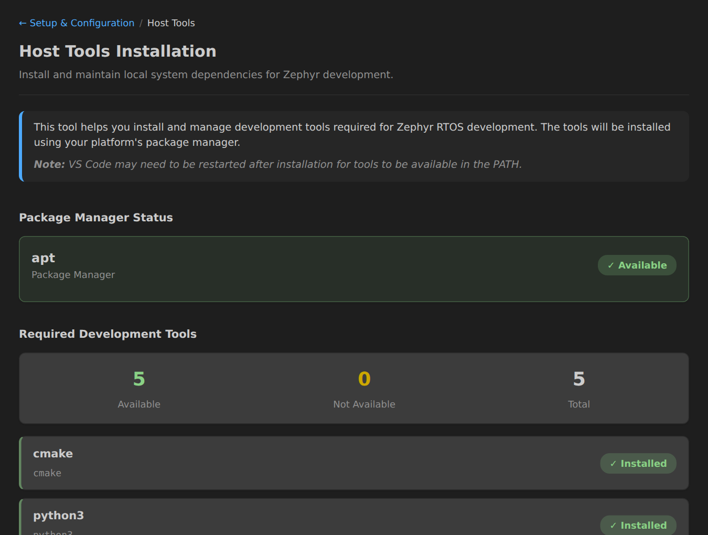

Click the Host Tools card to access the Host Tools sub-page. This page helps you install and verify the build dependencies required for Zephyr development.

## Checking Installed Tools

The extension verifies that required build dependencies are available on your PATH, including:

- **CMake** - Build system
- **Python3** - Scripting and tools
- **Devicetree Compiler (DTC)** - Device tree compilation
- **gcc** - Compiler

## Automated Installation

On supported platforms, the extension can automatically install missing dependencies using your system's package manager.

To install missing tools:

1. Click the **Host Tools** card in the Setup Panel
2. Review the list of detected and missing tools
3. Click **Install Host Tools** button
4. The extension will use your system's package manager to install missing tools

## Manual Installation

For unsupported platforms or if you prefer manual installation, follow the [Zephyr Getting Started Guide](https://docs.zephyrproject.org/latest/develop/getting_started/index.html#install-dependencies) to install the required dependencies.

## Supported Platforms

Automated installation is supported on:

- **Ubuntu/Debian** and derivatives - Uses `apt`
- **Fedora/RHEL/CentOS** and derivatives (Rocky Linux, AlmaLinux, etc.) - Uses `dnf`
- **Arch Linux** and derivatives (Manjaro, EndeavourOS, etc.) - Uses `pacman`
- **Clear Linux** - Uses `swupd`
- **macOS** - Uses Homebrew
- **Windows** - Uses winget

## Troubleshooting Windows Tool Detection

If winget or installed tools work in a terminal but appear unavailable in Zephyr IDE, VS Code may have inherited an incomplete or stale Windows environment.

Zephyr IDE checks the Windows environment on startup and warns about missing user variables or PATH entries, a TEMP value that differs from the registered user value, repeated user PATH entries, and user entries already present in the system PATH. You can rerun the check using **Check Windows Environment** in Zephyr IDE Settings or the **Zephyr IDE: Check Windows Environment** command. Select **Show Details** in the warning to see the findings in the Zephyr IDE output channel.

Open **Edit environment variables for your account** in Windows and review your user **Path** and **TEMP**. Remove duplicate Path entries and entries already present in the system Path; Windows combines the two. After correcting the values, sign out and back in, then restart VS Code and refresh Host Tools status. The check does not change environment variables or reinstall tools.

To disable the automatic check, turn off **Check Windows Environment on Startup** in Zephyr IDE Settings (`zephyr-ide.checkEnvironmentOnStartup`). The manual check remains available. Remote Linux environments such as WSL are not checked.

## Next Steps

After installing host tools:

- [Configure your Workspace](workspace-configuration.md)
- [Install the Zephyr SDK](sdk-installation.md)
