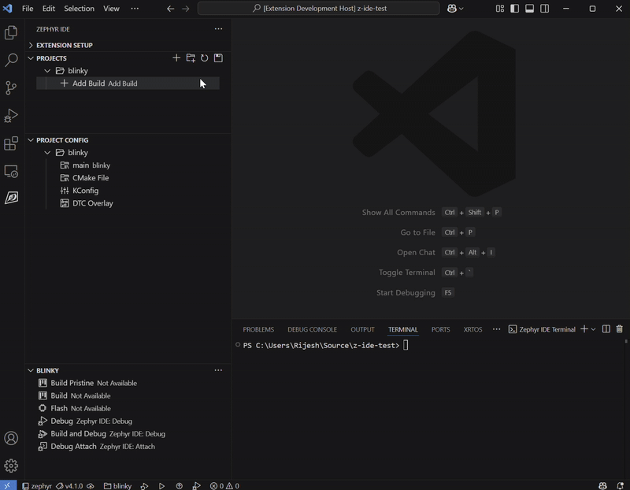

The extension supports running [Twister](https://docs.zephyrproject.org/latest/develop/test/twister.html) tests. Click the beaker icon in the IDE for Zephyr sidebar to access the test panel.

## Adding a Test

1. Click the beaker icon in the sidebar
2. Click **Add Twister Test** and select the test suite to add
3. Configure the test parameters (platform, selected tests, optional serial settings, and extra args)
4. Click **Run Test** or use `Zephyr IDE: Run Test` from the command palette

## Managing Tests

Tests are stored in `.vscode/zephyr-ide.json` alongside project and build configurations. Each test entry specifies:

- **Platform** — `native_sim`, a concrete QEMU platform such as `qemu_cortex_m3`, or `hardware`
- **Tests** — one or more test IDs (or `All`)
- **Extra args** — additional Twister arguments
- **Serial settings** — optional `serialPort` and `serialBaud` for hardware targets

When selecting QEMU, choose a concrete Twister platform; `qemu` by itself is not a valid platform. The wizard lists QEMU platforms detected via `west boards` for the active workspace — pick one, or choose **Enter platform manually...** to type one (e.g. `qemu_cortex_m3`). On Windows, set `QEMU_BIN_PATH` to the Zephyr SDK's `hosttools/qemu` directory before launching VS Code, or QEMU tests may build without being run.

Multiple test configurations can be added per project. Use `Zephyr IDE: Set Active Test` to switch the active test, and `Zephyr IDE: Reconfigure Active Test` to adjust parameters.

Use `Zephyr IDE: Delete Test Output Directories` to clean up Twister output between runs.

## Next Steps

- [Share your code with your team](sharing.md)
- [Explore other features](other-features.md)
